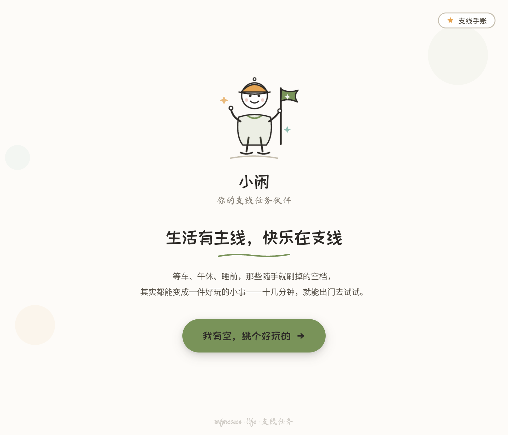
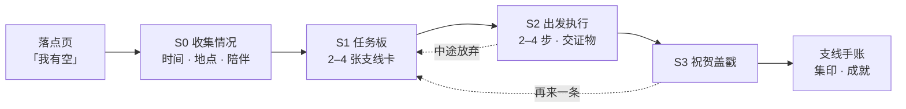
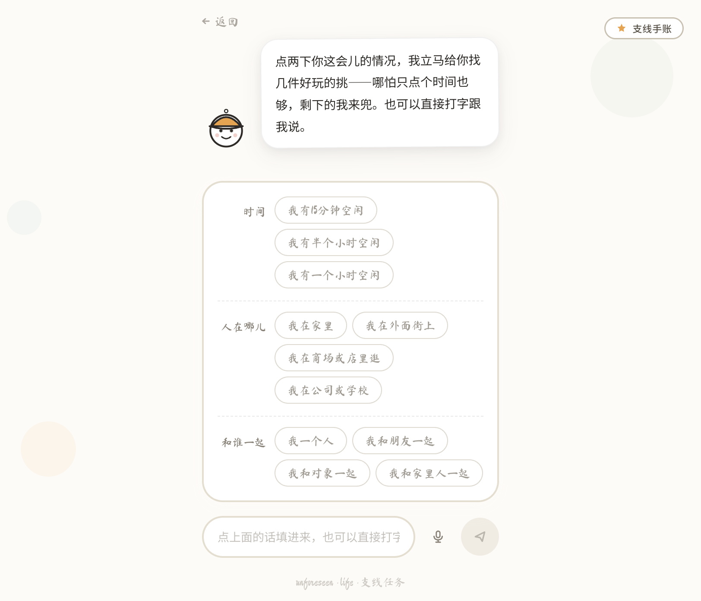
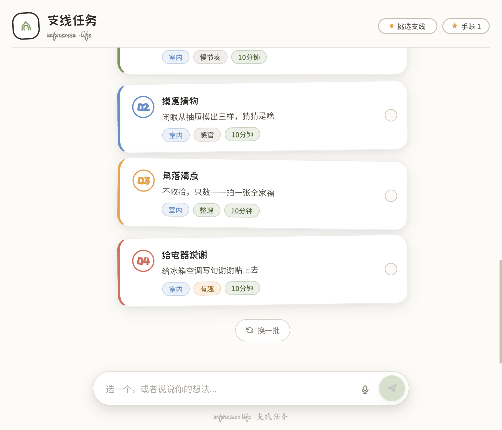
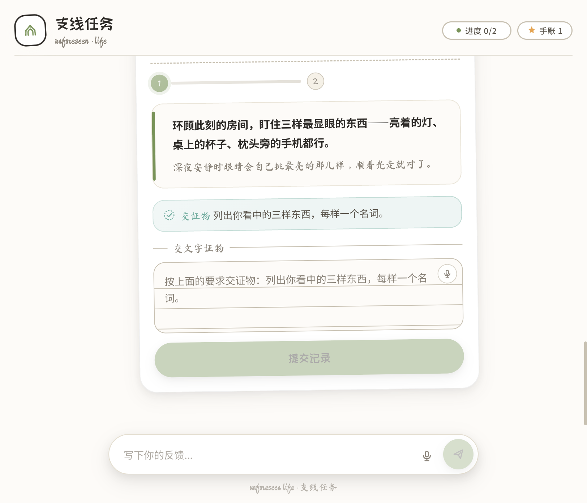
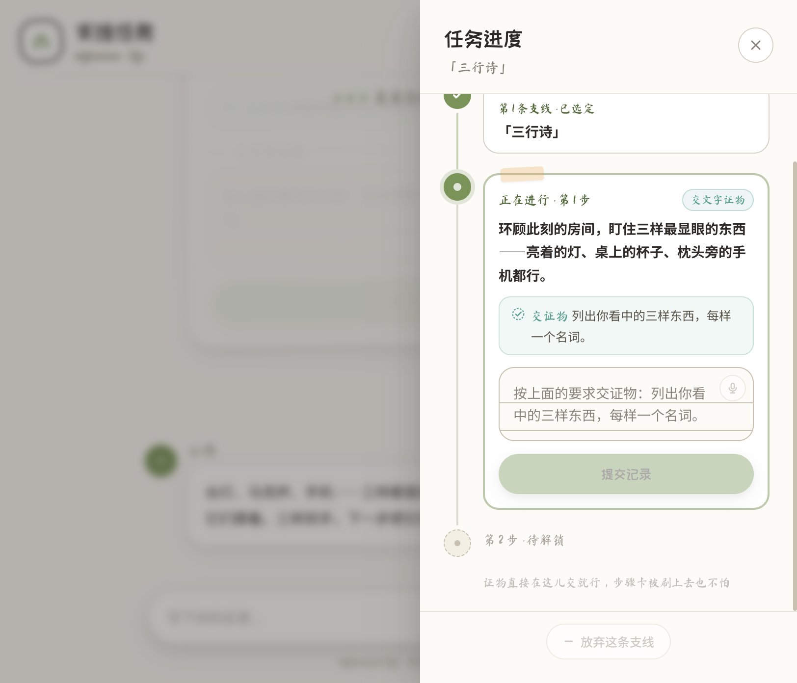
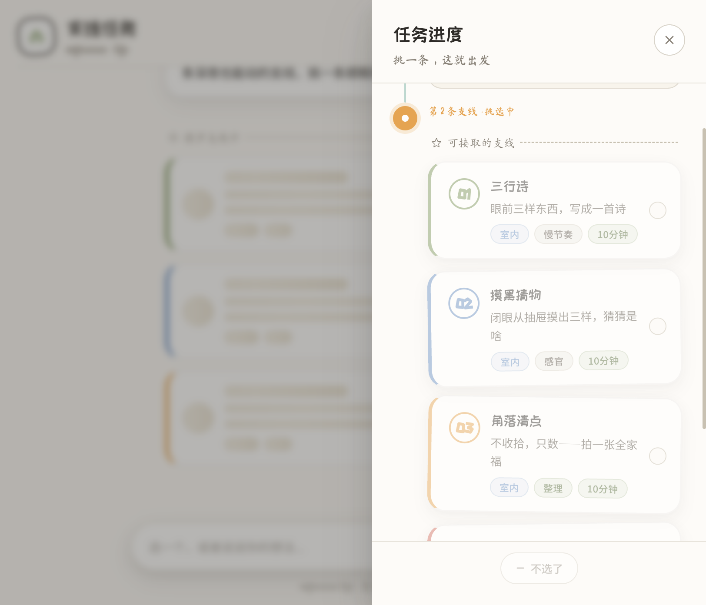
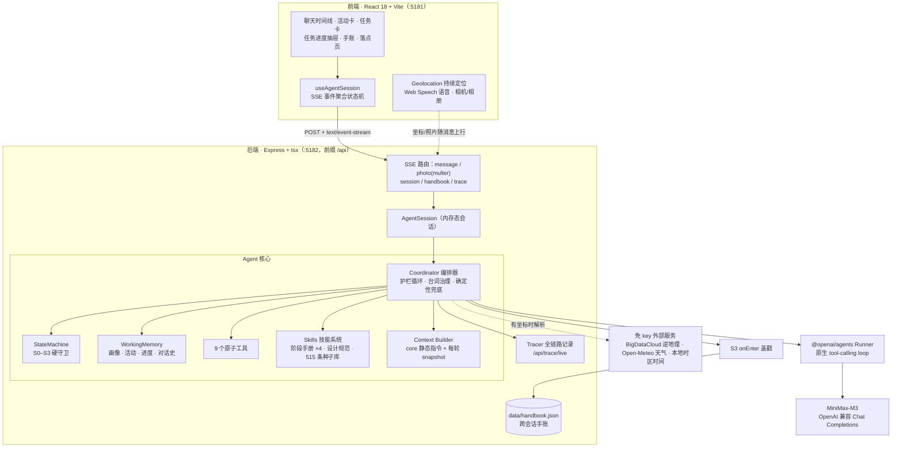
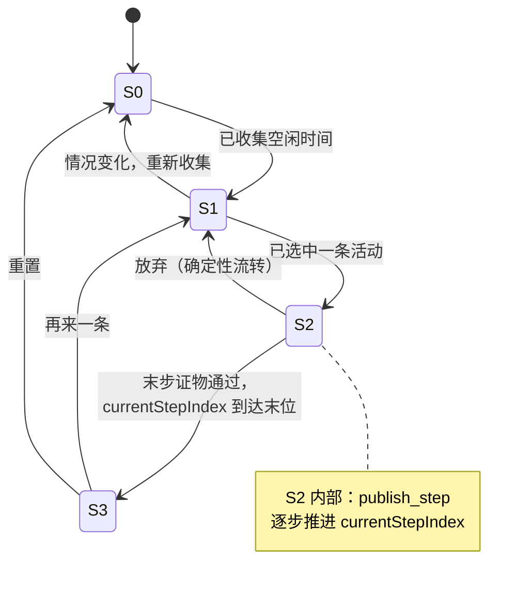
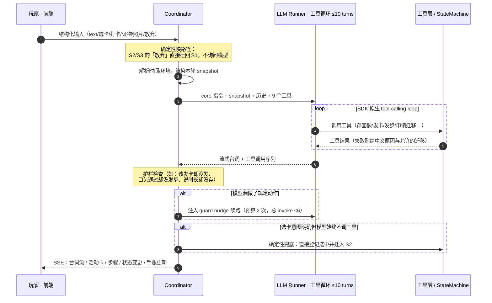

# 支线任务 · unforeseen life

> **生活有主线，快乐在支线。**
>
> 等车、午休、睡前，那些悄悄溜走的空档，其实都能变成一件轻盈的小事——十几分钟，就能出发去试试。

「支线任务」是一个由 AI 伙伴 **吱呀** 驱动的即时小游戏：告诉它你这会儿有多少时间、人在哪儿、和谁在一起，它就从你的碎片时间里找出一件**有趣、具体、马上能动身、做完有痕迹**的小事陪你完成；走完一条支线，就在你的「支线手账」里盖一枚戳。

<p align="center">
  
</p>

---

## 目录

- [产品故事](#产品故事)
- [使用方式：一条支线的完整旅程](#使用方式一条支线的完整旅程)
- [Agent 架构设计](#agent-架构设计)
- [快速开始](#快速开始)
- [目录结构](#目录结构)
- [技术栈](#技术栈)
- [设计语言](#设计语言)

---

## 产品故事

### 那些悄悄溜走的十五分钟

生活有一条主线——上班、上学、一件件该做的事。而大量碎片时间在等车、午休、睡前，于无意识里溜走了。这个产品想回答一个很小的问题：**手头这 15 分钟，除了刷手机，还能不能生长出一点什么？**

它不是一个任务清单，也不是内容推荐流。它把现实当成一场开放世界游戏：主线之外，处处都有「支线」——闭眼从抽屉摸出三样东西猜猜是什么、给冰箱空调写句谢谢贴上去、在通勤路上找出三种红色……十几分钟、零成本或低成本、就在此时此地。

### 吱呀：任务板后面那个伙伴

吱呀不是客服、不是老师、不是领导，是**专管支线的伙伴**。它的人设直接写在系统指令里（[core.ts](server/agent/prompts/core.ts)），几个关键侧面：

- **用字克制、举止老派**，说话留白不闹腾；但内里比玩家还容易投入——玩家真去做了，它偶尔没绷住漏出半句兴奋，随即翻回淡定。这种「露馅」一轮最多一次。
- **画面先于信息**：每轮开口先点一个此时此地看得见、摸得着、听得见的东西（「键盘上的碎光斑」「开水的响声」），再把正事带出来，不说空话和升华大词。
- **挑哪个、去不去，永远玩家说了算**。它只负责把候选备好、放上任务板，不派活、不催人。
- **对敷衍有点认真的小情绪**：玩家草草打卡时它看得见，会像朋友俯身过来看一眼——先说做到的部分，再说差的那一点。

它找的支线必须满足：**有趣、具体、十几分钟能出发、做完有痕迹**。每走完一条，玩家就多一段「今天没白过」的实感。

### 支线手账：让好玩留下痕迹

做完的支线会带着证物和日期收进跨会话持久化的「支线手账」（[handbook.ts](server/agent/handbook/handbook.ts)）。支线分五类——**探索 / 整理 / 创造 / 连接 / 感官**，手账据此集印，并从记录中确定性派生 9 枚成就徽章（初次出发、小有所获、闲不住的人、五类集齐，以及五类各做满 3 条的系列徽章）。

---

## 使用方式：一条支线的完整旅程

整个产品就是一次沿四阶段推进的对话，任何时候玩家都可以开口聊天、换一批、或者放弃这条支线。



### 1. 点两下你的情况

落点页之后不需要填表。吱呀先打个招呼，三组 chip 点两下就能交代清楚：**时间**（15 分钟 / 半小时 / 一小时）、**人在哪儿**、**和谁一起**——「哪怕只点个时间也够，剩下的我来兜」。也可以直接打字，或按住麦克风用语音说。

<p align="center">
  
</p>

### 2. 在任务板上挑一条合心意的

吱呀闲聊两句摸清你的状态、精力和预算后，会在聊天里挂上 **2–4 张支线卡**：每张卡只有序号、标题（≤6 字）、一句悬念钩子（≤20 字）和场景标签，**不带步骤**——避免为永远不会被选中的候选浪费生成。没感觉就「换一批」。

<p align="center">
  
</p>

### 3. 出发，一步一步交证物

选中后，支线的 **2–4 个步骤**才被当场设计出来并逐张发布。每一步都是一张可以**就地提交**的任务卡，验收方式有三种：

- **就位打卡**（check）：到了 / 开始了，一键确认；
- **文字证物**（text）：按要求写下具体内容（如列出三样东西、每样一个名词）；
- **拍照 + 回答**（photo）：拍一张现场照片并回答问题，**照片和回答同时齐备**才能提交，照片会直接喂给多模态模型「看图核对」。

证物不是走过场：模型会按该步的完成条件认真验收，敷衍的回答会被朋友式地驳回并给出怎么补的方向；末步必须是文字或照片证物，防止一键打卡敷衍整条支线。

<p align="center">
  
</p>

右上角的任务 tag 从 S1 起常驻 header（挑选支线 / 进度 x-y / 已完成 x-y），点开是**任务进度抽屉**：一条累积式时间轴串起历史支线（走完的 / 放下的）、挑选中的卡片、当前支线的每一步。**抽屉本身就是操作台**——当前步卡片内嵌完整提交表单，证物直接在抽屉里交，步骤卡在聊天里被刷上去也不怕；不想去了，底部「不选了 / 放弃这条支线」随时可退，放弃后立刻回到任务板换下一条，tag 和抽屉全程不消失。

<p align="center">
  
</p>

<p align="center">
  
</p>

### 4. 盖戳，收进手账

末步通过后进入 S3，吱呀只祝贺一个玩家自己都没留意的具体细节，支线随即盖戳进手账，并可能解锁新成就。然后可以「再来一条」——任务板已经在等你。

### 其他体验细节

- **定位与天气**：进入应用即请求定位授权；授权后每轮对话随消息带上坐标，后端解析出城市与实时天气注入吱呀的上下文，header 显示一枚「城市 · 天气」徽章；**未授权时徽章完全不显示**，任何定位/天气服务失败都静默降级，绝不阻断对话。
- **语音输入**：输入框与任务卡上都有麦克风按钮（Web Speech API），说话即可转文字。
- **任务 tag 常驻**：阶段切换时只换文案和颜色、不卸载组件，数据间隙用「构思支线…」这类过程态文案兜底，不闪烁、不消失。

---

## Agent 架构设计

核心命题是：**一个自由生成的 LLM，如何稳定地演出一场有严格规则的对话游戏**——不能跳阶段、不能空手发卡、不能替玩家做决定、不能放任敷衍、还必须始终说人话。整体方案是「**LLM 负责生成与判断，确定性代码负责规则与兜底**」。

### 总览



前端不做任何游戏规则判断，只把交互转为结构化消息、把 SSE 事件聚合成 UI 状态；规则全部在后端。会话保存在内存 `Map` 里（无数据库），只有手账落盘为 JSON 文件（`server/data/handbook.json`）。

### 四态状态机：游戏的骨架

对话沿 `S0 收集信息 → S1 推荐活动 → S2 执行任务 → S3 完成祝贺` **单向**推进（[state-machine.ts](server/agent/fsm/state-machine.ts)）。模型不能自己宣布换阶段，必须调用 `request_state_change` 工具申请，由状态机按守卫条件裁决：



每次非法迁移都会被拒绝，并把**中文原因 + `allowedTransitions` 作为工具结果回喂给模型**——模型读到后会自行补齐动作再重试，而不是把错误抛给玩家。迁移成功时执行副作用（如进入 S0 清空活动与执行作用域），并触发该阶段的 `onEnter` 钩子（S3 即在此盖戳、写手账、派发成就事件）。

### 单轮编排：工具循环 + 护栏循环 + 确定性兜底

[coordinator.ts](server/agent/coordinator/coordinator.ts) 是整个系统的大脑，一轮用户输入的处理如下：



三道保险层层递进：

1. **SDK 原生工具循环**（`@openai/agents` Runner，`maxTurns=10`）：模型自己决定调用工具，关键工具（发卡、发步）执行后通过 `stopAtToolNames` 让循环在出卡瞬间停下，把控制权交还给玩家。
2. **外层护栏循环**：每轮结束后对照「该阶段该做的动作清单」做检查，覆盖十余种偏差（首轮没取手册、说了时长却没存、S1 不出卡、S2 没设计步骤就说话、口头说「通过」却不发下一步、末步通过却不毕业……）。发现偏差就注入一句中文「护栏提示」续跑，轻推预算 2 次、总调用上限 6 次；**发生状态切换的轮次不消耗轻推预算**。
3. **确定性兜底**：不靠模型自觉的两个关键操作由代码直接执行——「放弃」在 S2/S3 直接迁回 S1 并当轮重新出卡；模型反复不调用选卡工具时，系统直接替它登记选择并进入 S2。

### 9 个原子工具

模型的全部「手」都收束在 [atom-tools.ts](server/agent/tools/atom-tools.ts) 的 9 个工具里。工具自带阶段限制与硬护栏（例如 `propose_activities` 只允许 S1 调用、活动必须 2–4 个；`design_activity_steps` 只允许 S2、步骤 2–4 个且末步必须是文字/照片证物）：

| 工具 | 阶段 | 职责 |
| --- | --- | --- |
| `save_user_info` | S0 | 结构化记录空闲时间、场景、人数、预算、体力、偏好、同伴、心情 |
| `propose_activities` | S1 | 发布 2–4 张支线卡（受「必须先说话」门控，卡片不带步骤） |
| `select_activity` | S1 | 登记玩家选中的支线 |
| `design_activity_steps` | S2 | 为**被选中的那一条**支线延迟设计 2–4 个步骤 |
| `publish_step` | S2 | 发布当前步骤；证物轮必须先通过验收，序号越界时回喂权威进度 |
| `request_state_change` | 全阶段 | 申请状态迁移，由状态机守卫裁决 |
| `get_skill` | 全阶段 | 按需加载阶段手册 / 设计规范 / 种子素材库 |
| `get_current_env` | 全阶段 | 查询当前城市与天气（通常无需调用，已默认注入） |
| `get_current_time` | 全阶段 | 查询北京时间与时段（同上） |

### 上下文工程：静态内核 + 每轮快照 + 按需技能

系统提示不是一整块大 prompt，而是分层装载（[builder.ts](server/agent/context/builder.ts)）：

- **CORE_INSTRUCTIONS（静态）**：吱呀是谁、怎么说话、语气红线、安全红线，会话期间不变；
- **snapshot（每轮重新渲染）**：当前阶段行（提示该读哪本手册）、**无条件注入的当前时间**（强制 Asia/Shanghai，含星期与凌晨/早上/中午等时段）、有坐标且解析成功时的环境段（城市 · 天气）、跨会话手账摘要、用户画像、S1 候选清单、S2 当前步指引与完成条件、S3 已完成活动；
- **对话历史**：走 SDK 的消息数组（`inputItems`），不进系统提示；现场照片只作为当轮多模态 part 附加，不写入文字历史；
- **技能（Skills）按需加载**：阶段手册和素材库不常驻 prompt，模型用 `get_skill` 取用，S0 手册在首轮确定性预载、S1/S2 手册随状态切换自动展开。

### 技能系统：Markdown 即手册，515 条种子防雷同

技能就是一组带 frontmatter 的 Markdown 文件（[skills/](server/agent/skills)，[loader.ts](server/agent/skills/loader.ts) 负责加载与缓存）：

- **4 本阶段行动手册** `playbook-s0~s3`：每个阶段「做什么、怎么做、什么心境」的 playbook；
- **活动设计规范** `activity-creative-design`：支线的质量标准；
- **素材库** `quest-library`：提炼自小红书等 UGC 的 **515 条灵感种子**，按户外 / 店里 / 场馆 / 家里 / 手工 / 社交 / 雨天夜晚 / 工位通勤 8 组归类，带玩法机制、类别、时长、场景、人数、预算、体力、新意等结构化标签；库内总结了 **10 大玩法机制**（随机委托、收集图鉴、视角重赋、规则限制、定点观察、触感心流、盲盒猜谜、角色扮演、连接动作、留痕收尾）。

素材库不是让模型照抄的菜单：硬规则要求支线时长 ≤ 玩家空闲的 80%、同批支线的机制与类别必须差异化、**禁止照抄种子必须当场改编**——种子负责把生成锚定在「真实可做、有人喜欢」的空间里，模型负责结合此刻情境再创作。

### 台词治理：让 Agent 始终只说人话

产品对「吱呀」的台词是零容忍的，治理分三层：

- **出卡前必须先说话**：`hasSpoken` 门控保证每次发卡/发步前模型必须先说一句承接玩家的话，默默出组件会被工具层拒绝；
- **流式净化**：跨 chunk 的状态机过滤器实时剥除括号舞台说明、图片 markdown、工具名/JSON 等元文本、链接和内部指令句，开场句还会按句过闸（拦截「好嘞/得嘞」等不合人设的口头禅），出卡瞬间拦截可能产生的第二段气泡；
- **验收与毕业的关键词硬拦截**：模型的自由判断之外再加一道确定性白名单——证物轮的文字必须被判定为「实质作答」，毕业轮台词必须命中「通过 / 完成 / 收工 / 齐活」等通过词才允许进入 S3；打卡类步骤则有豁免白名单防止误拦。**仅靠提示词约束不住模型对敷衍回答放行，关键词白名单是工具层的硬约束。**

### 多模态验收与环境感知

- **照片证物**：`/api/session/:id/photo` 用 multer 内存接收（≤5MB），转为 data URL 后与玩家的文字回答组成同一条多模态消息（`input_image` + `input_text`），由 MiniMax-M3 按该步完成条件「看图核对」。
- **逆地理与天气（全部免 API key）**：BigDataCloud 免费逆地理接口解析城市，Open-Meteo 获取实时天气；约 1km 网格 + 10 分钟 TTL 缓存、8 秒超时、双源 `Promise.allSettled` 互不拖累，任何失败都降级为只有坐标或什么都不注入。
- **时间**：本地用 `Intl` 强制 Asia/Shanghai 渲染，不依赖服务器时区，永远可用，因此每轮无条件注入。

### 事件流与可观测性

后端所有产出都通过一条 SSE 流推送：`turn_start` / `text_delta`（台词流）、`thinking_start|end`、`tool_call` / `skill_loaded`、`activities_proposed`、`step_published`、`state_changed`、`env_resolved`、`task_completed`、`handbook_updated`、`turn_complete`。前端 `useAgentSession` 复用同一事件流聚合任务进度（以 `step.index=0` 识别新支线、按序号累积去重）与抽屉时间轴，无需额外轮询接口。

调试面板 `http://localhost:5181/debug.html` 基于 `/api/trace/sessions` 与 `/api/trace/live`（SSE 实时流）展示每次 LLM 调用的消息、分层装载字数、工具序列与护栏续跑，便于观察 Agent 的真实决策过程。

---

## 快速开始

### 环境要求

- Node.js 18+（依赖全局 `fetch`）
- 一个 OpenAI 兼容的 Chat Completions 服务密钥（默认配置为 MiniMax 开放平台的 MiniMax-M3）

### 安装与配置

```bash
# 1. 安装前端依赖（仓库根目录）
npm install

# 2. 安装后端依赖
cd server && npm install && cd ..

# 3. 配置后端环境变量：新建 server/.env
```

`server/.env` 示例（请填入你自己的密钥，不要提交真实密钥）：

```dotenv
OPENAI_API_KEY=sk-你的密钥
OPENAI_BASE_URL=https://api.minimaxi.com/v1
OPENAI_MODEL=MiniMax-M3
PORT=5182
# 可选：显式指定使用 Chat Completions 协议（配置了 BASE_URL 时默认开启）
# OPENAI_USE_CHAT_COMPLETIONS=true
```

### 启动

```bash
npm run dev
```

一条命令通过 concurrently 同时拉起：

- **前端** Vite：<http://localhost:5181>（固定端口，`/api` 代理到后端，含 SSE 头处理）
- **后端** Express + tsx watch：<http://localhost:5182>（API 前缀 `/api`，改代码自动热重载）

调试面板：<http://localhost:5181/debug.html>

### 主要 HTTP 接口

| 方法与路径 | 说明 |
| --- | --- |
| `POST /api/session` | 以 clientId 创建会话（内存态） |
| `GET /api/handbook?clientId=` | 读取跨会话支线手账与成就 |
| `POST /api/session/:id/message` | 发送文字/选卡/打卡/文字证物/放弃，返回 **SSE 事件流** |
| `POST /api/session/:id/photo` | multipart 上传照片证物（photo + description + geo），返回 SSE |
| `GET /api/trace/sessions` · `/api/trace/live` | 调试用会话记录与实时 trace 流 |

生产构建：`npm run build`（`tsc -b && vite build`）。

---

## 目录结构

```
.
├── src/                        # 前端（React 18 + Vite + Tailwind）
│   ├── App.tsx                 # 主屏、header 任务 tag/徽章、抽屉编排
│   ├── api.ts                  # SSE/fetch 封装（消息、照片、坐标上行）
│   ├── types.ts                # 前端领域类型与 SSE 事件载体
│   ├── components/
│   │   ├── LandingScreen.tsx   # 落点两屏（hero + 情况点选）
│   │   ├── ActivityCards.tsx   # S1 支线卡
│   │   ├── TaskStep.tsx        # S2 步骤卡，导出共享的 StepSubmitArea
│   │   ├── QuestDrawer.tsx     # 任务进度抽屉：累积时间轴 + 就地提交 + 放弃
│   │   ├── HandbookView.tsx    # 支线手账（集印册 + 成就墙）
│   │   ├── CompletionScreen.tsx / ChatMessage.tsx / DockSkeleton.tsx
│   │   ├── VoiceButton.tsx / XianMascot.tsx / TraceDashboard.tsx
│   └── hooks/
│       ├── useAgentSession.ts  # SSE 事件 → 对话/任务/归档/环境状态机
│       ├── useGeolocation.ts   # watchPosition 持续定位
│       └── useSpeechInput.ts   # Web Speech 语音输入
├── server/
│   ├── index.ts                # Express 路由、SSE、multer 照片上传
│   ├── .env                    # 本地密钥配置（不入库）
│   ├── data/handbook.json      # 跨会话手账持久化
│   └── agent/
│       ├── session.ts          # AgentSession：会话容器
│       ├── coordinator/        # 编排器：护栏循环、台词治理、确定性兜底
│       ├── fsm/                # S0–S3 状态机与迁移守卫
│       ├── tools/              # 9 个原子工具
│       ├── context/            # core + snapshot 分层上下文
│       ├── skills/             # Markdown 技能：4 本手册 + 设计规范 + 515 种子
│       ├── memory/             # WorkingMemory 与类型
│       ├── flows/              # 四阶段 onUserInput / onEnter 钩子
│       ├── prompts/            # 吱呀核心指令、工具描述
│       ├── llm/                # @openai/agents Runner 接线与流式回调
│       ├── env/                # 逆地理、天气、北京时间（免 key、全降级）
│       ├── handbook/           # 手账记录与成就派生
│       └── tracer/             # 全链路 trace
├── docs/
│   ├── design-spec.md          # 视觉设计规范（蜡笔手账风格）
│   └── images/                 # 本 README 使用的产品截图与架构图
└── package.json
```

---

## 技术栈

| 层 | 选型 |
| --- | --- |
| 前端 | React 18、TypeScript 5.6、Vite 5、Tailwind CSS 3、react-markdown、Web Speech API、Geolocation API |
| 后端 | Node.js、Express 4、tsx watch、multer（照片上传）、SSE |
| Agent | [@openai/agents](https://github.com/openai/openai-agents-js) 原生工具循环 + @openai/agents-openai（Chat Completions 协议）、zod（工具参数校验） |
| 模型 | MiniMax-M3（多模态、工具调用；可经环境变量切换为任意 OpenAI 兼容端点） |
| 外部服务 | BigDataCloud 逆地理、Open-Meteo 天气（均免 key） |
| 持久化 | 会话内存态；手账为本地 JSON 文件；无数据库 |

---

## 设计语言

界面采用「蜡笔手账」风格：奶油纸底、手绘描边、胶带贴纸、 moss 绿主色与三档中文手写字体，呼应「把支线盖戳进手账」的产品隐喻。完整规范见 [docs/design-spec.md](docs/design-spec.md)。
