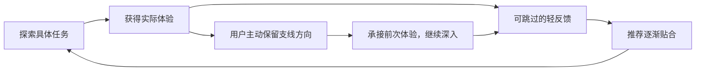
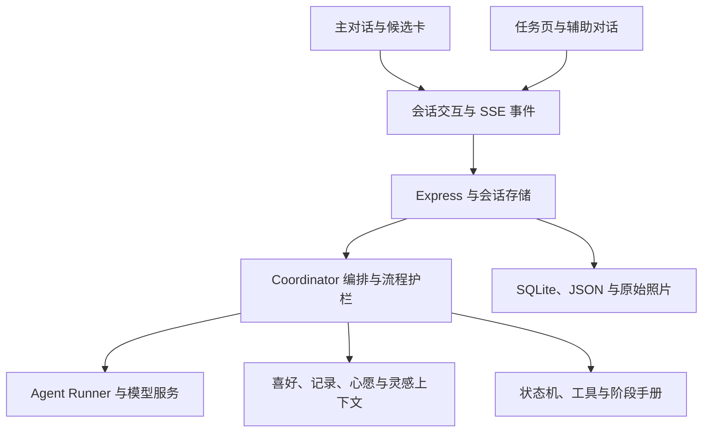

# 支线任务 · unforeseen life

> 生活有主线，快乐在支线。

「支线任务」是一个由 AI 伙伴 **吱呀** 协助用户发现、尝试和持续探索有趣事情的应用。用户可以寻找一个现在能开始的任务，也可以围绕喜欢的事情继续做下去。

项目围绕两项核心能力展开：

1. **支线探索**：结合用户的喜好和现实条件，推荐具体可做的事情，让用户有机会接触不同的玩法与兴趣。
2. **支线维护**：根据用户的喜好和实际反馈，逐渐收敛方向，在用户愿意保留的几条支线上持续尝试、深入和改进。

用户可能从中获得放松、惊喜、表达、连接，或者朝某个愿望前进一点。具体收益由用户的喜好和体验决定。时间、地点、预算和同行情况用于判断一次任务是否适合开展。

**当前版本已具备探索推荐、喜好拟合、独立任务页、支线脉络、心愿计划、灵感收藏和记录恢复。支线主题可手动组织并继续探索，自动反馈学习与方向收敛仍处于方案阶段。** 本 README 将产品方向与当前实现分别说明。

## 目录

- [产品定位与核心概念](#产品定位与核心概念)
- [当前功能与使用流程](#当前功能与使用流程)
- [后续演进方向](#后续演进方向)
- [快速开始](#快速开始)
- [构建与部署](#构建与部署)
- [架构与目录](#架构与目录)
- [数据保存与恢复](#数据保存与恢复)
- [验证与测试](#验证与测试)
- [相关文档](#相关文档)

## 产品定位与核心概念

探索帮助用户发现更多可能性，维护帮助用户把其中喜欢的几条继续发展。两者可以交替发生；一次有趣的尝试可以独立结束，也可以成为持续兴趣的起点。

例如，用户先尝试观察街区的窗户，发现自己喜欢建筑细节，之后继续观察不同的线条、颜色或构图。有明确成果意愿时，再把这些积累整理成一本小册。用户也可以一直享受观察本身。

| 概念 | 含义 | 当前状态 |
| --- | --- | --- |
| 具体任务 | 这一次可以做的一件事，有动作、步骤和完成要求 | 已实现 |
| 支线方向 | 用户愿意持续探索的一类事情，可以没有终点 | 已支持自建主题、归入经历、回看与继续探索；自动收敛仍待实现 |
| 心愿计划 | 围绕明确愿望组织的有序章节，每次推进一章 | 已实现 |
| 日常记录 | 已完成任务及其原始文字、照片和日期 | 已实现 |
| 灵感收藏 | 用户以后可能想尝试的具体想法或素材，可参与推荐 | 已实现 |

支线方向用于承接持续兴趣；心愿计划承接明确成果。现有心愿计划提供了持续实践的基础，尚不能覆盖全部开放式方向维护场景。

## 当前功能与使用流程

### 1. 快速进入探索

首页支持语音、键盘和时间／位置／同行快捷短语。可以直接说“在家，有十五分钟”，或描述自己的想法。当前推荐流程以可用时长为起点，其他条件说了就使用，不逐项要求填写；没有想法时可按十五分钟快速开始。

首次引导保留四个简短模块：用途介绍、两次点击的玩法演示、基础喜好、可选心愿。喜好和心愿均可跳过，演示不写入正式任务记录。

### 2. 在对话中挑选具体任务

**选中任务前，LUI（对话交互）为主，GUI（图形界面）穿插其中。** 吱呀在对话里给出候选卡，用户可以选择、换一批，或继续描述限制与想法。

普通候选在选中后才设计步骤；符合条件的心愿章节和收藏灵感也可以进入推荐。当前推荐会参考喜好档案、问卷摘要及已完成记录，但尚无独立的实际体验评价学习闭环。

### 3. 在任务页完成行动

**选中任务后，GUI 为主，对话作为辅助。** 页面立即进入任务准备状态，随后集中展示任务名称、进度、当前步骤、建议计时和提交要求。

- 当前步骤只有一个提交入口，文字记录或照片加说明集中在任务页提交。
- 需要帮助时点“问问吱呀”：桌面打开辅助侧栏，手机打开全屏辅助对话，返回后继续当前步骤。
- 辅助对话和首页往返保留未提交内容、照片预览及计时状态；提问不会恢复用户手动暂停的计时。
- 提交失败保留输入；需要补充内容时可直接修改原文重试。
- 当前主要提交类型为文字和照片，仍有证物验收要求；体验型任务的可选记录属于后续方案。

主流程已采用独立任务页，原聊天内提交与任务进度抽屉不再作为当前操作入口。

### 4. 查看成果，继续探索

完成后在任务页展示结果，可进入日常记录，或返回对话寻找下一条支线。“我的手册”默认打开支线脉络，同时保留喜好、心愿计划、日常记录和灵感收藏，共五个栏目。

| 功能 | 当前能力 |
| --- | --- |
| 支线脉络 | 按放松、惊喜、表达、连接、成长五个方向展示任务地图、个人主题与心愿章节；按时间回看原始作品，可跨方向串入经历，编辑或移除主题；继续探索时携带主题和最近经历进入新对话 |
| 基础喜好 | 入门设置 MBTI、喜动或喜静，以及放松／惊喜／表达／连接／成长等期待；正式页面可进一步编辑体力、预算、兴趣、雷点与玩法偏好 |
| 喜好配置拟合 | 独立三十组两两对比，覆盖六个方向；支持平局、跳过、续答和回改，最后确认后保存 |
| 心愿计划 | 用一句话描述愿望，结合现有喜好生成章节；预览确认后启用，可暂停、续接和回看真实成果 |
| 日常记录 | 保存完成任务、逐步原文和照片，并从记录派生成就 |
| 灵感收藏 | 输入想法、文案或公开链接，整理后预览、修改、确认收藏；支持暂停和恢复推荐 |
| 会话恢复 | 刷新或重新打开后恢复当前会话、候选、执行步骤和已保存提交 |

喜好拟合采用带正则的线性 Bradley–Terry 模型，展示相对趋势与作答信息，不把结果解释为人格结论或准确率。基础设置、问卷和心愿功能保持独立，用户可以按需要使用。

脉络中的自动分类只说明体验方向相同，不表示任务之间有前置依赖。个人主题由用户命名并挑选已完成经历，同一经历可以出现在不同主题中；移除主题不会删除任务或作品。心愿线路以真实章节记录标记完成，未完成章节保持下一站、进行中或待解锁状态。进行任务时不能从脉络另开探索，以免打断当前实践。新推荐不会自动归入个人主题，完成后可自行整理。

### 演示模式

在页面右下角的小圆点打开演示设置，或按 `Alt+Shift+D`，开启演示模式。也可在产品地址后加 `?demo=1` 直接进入。演示控制台可快速跳转任务体验、任务地图、偏好画像、心愿计划、灵感收藏、日常记录和新手教程。

预置 15 条完成记录、2 条跨方向主题、30 组喜好答案、3 种状态的心愿及 3 条灵感。任务记录、照片、灵感和心愿表单提供示例按钮，无需现场输入。演示数据独立保存在本机，所有业务接口在前端本地处理；关闭后恢复原模式，重置只清理演示数据。演示不会请求定位或麦克风，朗读使用设备语音，文字流程不依赖模型额度。详细演示路径见[演示模式说明](docs/demo-mode.md)。

### 语音、定位与浏览器能力

首页和选任务前的沉浸通话支持语音交互；进入具体任务后回到任务页。语音输入使用浏览器的识别能力，吱呀朗读通过后端调用 MiniMax TTS，需要单独配置。

语音识别受浏览器支持、安全上下文、权限和服务连通性影响。无法使用时可切换键盘输入；允许麦克风不代表语音识别服务一定可用。

新手引导期间不申请定位；开始支线后请求定位授权。有坐标时后端可解析城市和天气，失败或未授权不阻断主要流程。

## 后续演进方向

下一阶段重点是连接探索、实际反馈与持续实践：



其中，轻反馈、独立支线方向和方向级推荐调整尚未实现。具体建议见[支线探索与维护调整方案](docs/exploration-and-depth-proposal.md)。

拟优先补齐：

- 可修改、可撤回的实际体验反馈，与问卷答案分别保存。
- 用户主动保留、暂停、恢复并继续某个支线方向。
- 根据上次体验和当下条件推荐下一次任务，兼顾熟悉方向与新探索。
- 将明确成果的实践与现有心愿计划关联，复用历史记录和作品。

完成任务、喜欢体验、愿意长期继续是不同的信息。后续推荐需要分别理解这些信号，不把一次选择或中途放下直接解释为永久偏好。

以上属于演进方案，本 README 的更新不改变应用界面、助手提示或当前执行规则。

## 快速开始

以下开发命令面向个人本地开发环境。在 ASteam 沙箱部署时，使用下文的托管方式。

### 环境要求

- Node.js **22 或更新版本**，npm；当前 SQLite 依赖要求 Node.js 22+。
- 配置对话与工具调用所需的模型服务；照片验收还要求所选服务和模型支持图像输入。
- 语音输入需要兼容浏览器；TTS 使用独立的 MiniMax 服务配置。

### 安装与配置

在项目根目录执行：

```bash
npm ci
npm ci --prefix server
cp server/.env.example server/.env
```

编辑 `server/.env`，按实际服务填写以下配置；完整模板见 [server/.env.example](server/.env.example)。密钥只保存在环境变量或忽略提交的配置文件中。

| 配置 | 用途 |
| --- | --- |
| `OPENAI_API_KEY` | 对话、任务生成与相关模型调用的服务密钥 |
| `OPENAI_BASE_URL` | 自定义模型服务地址；配置后主 Agent 使用 Chat Completions 接线 |
| `OPENAI_MODEL` | 明确指定实际模型，避免不同组件使用各自的默认值 |
| `PORT` | 后端监听端口；本地开发模板为 `5182`，平台部署使用平台注入值 |
| `XIAN_DATA_DIR` | 可选的数据持久化目录，建议部署时使用固定绝对路径 |
| `MINIMAX_API_KEY` | 可选，启用吱呀语音合成 |
| `MINIMAX_TTS_MODEL`、`MINIMAX_VOICE_ID`、`MINIMAX_API_BASE` | 可选，语音合成的模型、声音和服务地址 |

模板使用 DeepSeek 官方服务 `https://api.deepseek.com` 和 `deepseek-flash`。DeepSeek 请求关闭思考模式，以保持即时对话和强制工具验收的兼容；主对话、心愿规划、灵感整理和证物验收共用配置。模型名称与能力以 [DeepSeek 官方文档](https://api-docs.deepseek.com/quick_start/pricing/) 为准。

产品的 `server/.env` 中对话模型与 MiniMax 语音配置优先于沙箱继承的默认值，平台注入的 `PORT` 始终优先。密钥文件不入库，文件权限建议设为 `600`。使用 DeepSeek 时设置 `OPENAI_AGENTS_DISABLE_TRACING=1`，关闭 OpenAI 托管追踪，保留产品自身的本地调试记录。更换服务时应同时核对工具调用、流式输出和照片输入的兼容性。

MiniMax 语音使用 `speech-2.8-turbo` 与 `qiaopi_mengmei`（俏皮萌妹），供沉浸对话中的朗读及「听听吱呀的新声音」使用。后端仅在官方返回成功状态及有效音频时响应 MP3；配置密钥本身不代表服务已验证通过。若官方返回 `2049: invalid api key`，需要在开放平台更新有效接口密钥后重载产品。

`MINIMAX_API_BASE` 必须与密钥所属站点一致：国内站使用 `https://api.minimaxi.com/v1`，国际站使用 `https://api.minimax.io/v1`。国际站密钥请求国内接口可能显示密钥无效；正确站点返回 `1008: insufficient balance` 时，需要先补充该站点的 API 可用余额，再验证语音生成。

### 本地开发

```bash
npm run dev
```

该命令同时启动前后端：

- 前端：`http://localhost:5181`。
- 后端：`http://localhost:5182`，前端代理 `/api` 和 `/evidence`。
- 开发追踪页：`http://localhost:5181/debug.html`。

本地 Vite 代理目标在 [vite.config.ts](vite.config.ts) 中配置；只修改后端端口不会自动修改代理目标。

`GET /api/health` 返回服务状态和 `aiConfigured`。后者仅表示配置了模型密钥，不代表已经验证模型连接或生成质量。

## 构建与部署

### ASteam 托管

本项目已有 [app.toml](app.toml) 和 [start.sh](start.sh)：

```toml
name = "支线任务 · unforeseen life"
start = "sh start.sh"
health = "/api/health"
```

将产品目录放在当前工作区的 `products/unforeseen-life/`，由平台读取配置、注入 `PORT` 并管理进程，无需另外手动启动服务器。

启动脚本按锁文件恢复缺失依赖，构建前端和后端，再由同一个 Express 进程提供页面、API 和照片，监听 `0.0.0.0:$PORT`。平台入口位于根路径 `/`，使用普通 `npm run build` 的构建结果。

### 其他部署环境

准备依赖和服务端环境变量，运行：

```bash
npm run build
npm --prefix server run build
npm --prefix server start
```

部署环境须提供有效的 `PORT`，并让服务进程可以读取密钥与数据目录。前端产物为根目录 `dist/`，后端产物为 `server/dist/`；保持两者的目录关系。后端构建还会复制 Agent 的 Markdown 手册，发布时需要包含完整构建产物。

反向代理如有启用，应保留 SSE 流式响应，页面、`/api` 和 `/evidence` 使用同一服务入口。代码更新时保留数据目录。

### 兼容的子路径预览

仓库还保留 `npm run preview:local`，用于个人本地的 `/unforeseen-life/` 子路径预览；该命令会构建子路径资源并启动配套前后端，入口为 `http://localhost:5183/unforeseen-life/`。

此模式与 ASteam 根路径托管分开使用。单独执行 `npm run preview` 只启动静态预览，仍需配套后端；子路径构建产物不能直接用于平台根路径入口。

## 架构与目录

前端负责交互与事件呈现，后端负责任务阶段、模型调用、提交核对和持久化。主流程为 `S0 收集条件 → S1 推荐任务 → S2 执行任务 → S3 完成`，并支持重新推荐、放下任务和开始下一轮。



关键实现：

- **交互层**：`ConversationPanel` 承接选前主对话和选后辅助对话，`TaskWorkspace` 提供当前任务的集中操作。
- **Agent 层**：模型生成候选与步骤；状态机、工具校验和编排护栏约束阶段推进。普通任务只为被选中的候选设计步骤。
- **上下文层**：静态助手设定、当前状态、近期对话、喜好档案和已有成果共同参与生成；阶段手册按需加载或在转场时预载。
- **持久化层**：运行中的会话有内存实例，同时将快照、事件和原始提交保存到 SQLite；心愿与收藏使用各自数据库，喜好和日常记录使用 JSON。
- **可观测性**：追踪页展示模型调用、工具和护栏行为，供开发调试。

```text
.
├── src/
│   ├── App.tsx                    # 首页、会话、任务页与手册编排
│   ├── session-restore.ts         # 已保存会话的前端回放
│   ├── components/
│   │   ├── ConversationPanel.tsx  # 主对话／辅助对话
│   │   ├── TaskWorkspace.tsx      # 当前任务与完成页
│   │   ├── TaskStep.tsx           # 文字与照片提交组件
│   │   ├── PersonalLibrary.tsx    # 我的手册及栏目
│   │   ├── PreferenceSheet.tsx    # 基础喜好
│   │   ├── PreferenceFittingPanel.tsx
│   │   ├── GoalsView.tsx          # 心愿计划
│   │   ├── HandbookView.tsx       # 日常记录与成就
│   │   └── InspirationView.tsx    # 灵感收藏
│   └── hooks/                    # 会话、语音、定位与计时
├── server/
│   ├── index.ts                  # HTTP、SSE、静态资源与照片
│   ├── session-store.ts          # 会话快照、事件与恢复
│   ├── goal-store.ts             # 心愿章节与真实成果
│   ├── goal-planner.ts            # 心愿规划与校验
│   ├── inspiration.ts            # 灵感整理、存储与推荐
│   ├── minimax-tts.ts            # 服务端语音合成
│   └── agent/                    # 编排、状态机、工具、喜好与技能
├── tests/                        # 数据、流程与共享浏览器回归
├── docs/                         # 设计规范、功能说明与演进方案
├── app.toml                      # 平台托管配置
├── start.sh                      # 托管启动入口
└── vite.config.ts                # 本地代理、构建与预览
```

技术栈：React 18、TypeScript、Vite、Tailwind CSS；Node.js、Express、SSE、SQLite；Agent Runner、结构化工具与 Markdown 阶段手册。

### 主要接口

| 接口 | 用途 |
| --- | --- |
| `POST /api/session` | 创建会话 |
| `GET /api/session/active`、`GET /api/session/:id` | 查询与恢复已保存会话 |
| `POST /api/session/:id/message` | 文字、选卡、文字提交或放下任务，返回 SSE |
| `POST /api/session/:id/photo` | 照片和说明提交，返回 SSE；单文件上限 5 MB |
| `GET /api/profile`、`PUT /api/profile` | 读取与保存基础喜好 |
| `GET /api/quest-pairs`、`PUT /api/profile/fitting` | 获取对比问卷与保存拟合答案 |
| `/api/goals`、`/api/inspirations` | 心愿计划和灵感的读取与维护 |
| `GET /api/handbook` | 日常记录与成就 |
| `POST /api/tts` | 合成吱呀语音 |
| `GET /api/health` | 健康检查 |

会话、心愿和收藏等接口使用 `X-Client-Id` 检查归属，部分既有档案接口从查询或请求体读取标识。具体参数见 [server/index.ts](server/index.ts)。当前为匿名设备标识隔离，不等同于账户认证；追踪接口面向开发调试。

## 数据保存与恢复

按现有启动方式运行时，数据默认保存在 `server/data/`；底层路径以服务进程的工作目录为基准。部署时可以通过 `XIAN_DATA_DIR` 设置固定数据目录。

| 数据 | 保存位置 |
| --- | --- |
| 会话快照、可见事件和原始提交 | `sessions.sqlite` |
| 心愿计划、章节记录和进度 | `goals.sqlite` |
| 个人支线主题、说明与经历引用 | `quest-threads.sqlite` |
| 灵感原文、来源和整理结果 | `inspirations.sqlite` |
| 基础喜好与问卷答案 | `profile.json` |
| 完成记录与作品引用 | `handbook.json` |
| 原始照片 | `evidence/` |

同一浏览器刷新或重新打开应用时，会恢复当前选择的会话；没有选择记录时查找最近会话。关闭页面不会取消服务器正在处理的回合，恢复时同步最新状态。服务重启导致的中断会保留已保存的提交，不自动重新调用模型或重复交作品。

当前任务的文字草稿和照片说明保存在本机 `sessionStorage`，刷新可恢复；照片文件只在当前页面内保留，刷新后需要重选。未发送的聊天输入在辅助对话往返时保留，软计时器不跨刷新保存。

首次引导状态、心愿草稿和问卷草稿等使用浏览器本机存储。换设备或清除浏览器数据后，匿名标识与本机草稿可能丢失，当前不承诺跨设备恢复。

迁移或备份时应完整保留数据目录。简单备份可停服后复制；在线 SQLite 备份应使用其备份机制，不能只复制正在写入的单个数据库文件而忽略 WAL。当前存储方式面向单机单进程部署，多实例需要另行设计共享存储。

## 验证与测试

本节列出仓库现有验证入口，不代表每次文档更新都重新执行了全部测试。

| 命令 | 覆盖内容 |
| --- | --- |
| `npm run build` | 前端类型检查与生产构建 |
| `npm --prefix server run build` | 后端编译与运行手册复制 |
| `npm run test:persistence` | 会话落盘、恢复、隔离、去重和服务中断 |
| `npm run test:preferences` | 问卷结构、拟合、兼容与保存 |
| `npm run test:goals` | 心愿章节、约束、归属、结算与恢复 |
| `npm run test:models` | 产品模型配置优先级、平台端口保留及 DeepSeek 参数兼容 |
| `npm run test:speech` | 语音识别状态、取消、竞态和错误处理 |
| `npm run test:task-ui` | 选前对话、选后任务、辅助对话、提交重试和草稿保持 |
| `npm run test:onboarding` | 首次引导、跳过、保存失败及恢复 |
| `npm run test:preferences:ui` | 完整喜好问卷、续答、回改与屏幕适配 |
| `npm run test:threads` | 主题归属、落盘、记录验证、时间连接与真实章节状态 |
| `npm run test:threads:ui` | 地图、作品回看、主题增改移除、保存重试、继续探索与任务保护 |
| `npm run test:demo` | 预置数据、任务结算、幂等重试、会话恢复、心愿续接及本地存储 |
| `npm run test:demo:ui` | 开关、完整示例流程、五个方向、手机布局、重置退出及真实数据隔离 |

主要 UI 脚本连接已有共享浏览器，需具备 Playwright 和可访问的应用，不会自行启动浏览器。使用隔离身份和拦截的请求验证交互，不写入真实用户档案。可通过 `PLAYWRIGHT_MODULE` 指定已有 Playwright 安装，通过 `TASK_TEST_URL`、`ONBOARDING_TEST_URL`、`PREFERENCE_TEST_URL` 分别指定应用地址；喜好 UI 脚本还需先构建后端。

上述三个 UI 脚本覆盖 320×568、390×844、844×390、1280×900。真实模型的任务质量、照片理解、手机相机、软键盘和真实语音仍需相应环境下验收。未配置服务时，模拟交互通过不能代替这些结论。

## 相关文档

- [支线探索与维护调整方案](docs/exploration-and-depth-proposal.md)：产品定位、方向维护、反馈闭环与分批调整建议；状态为待评审。
- [设计规范](docs/design-spec.md)：视觉语言、当前主流程、教程和喜好拟合约定。
- [心愿计划实现说明](docs/long-term-quests-implementation.md)：章节、前序成果与结算实现；部分早期页面描述以当前代码和设计规范为准。
- [灵感收藏与语音说明](docs/inspiration-and-voice.md)：来源处理、推荐及语音实现；测试记录对应文档编写时版本。

历史截图和早期方案保留在 `docs/` 中，部分画面仍包含旧任务抽屉，不作为当前交互的准确展示。当前界面沿用奶油纸底、手绘细节与苔藓绿的既有风格。
