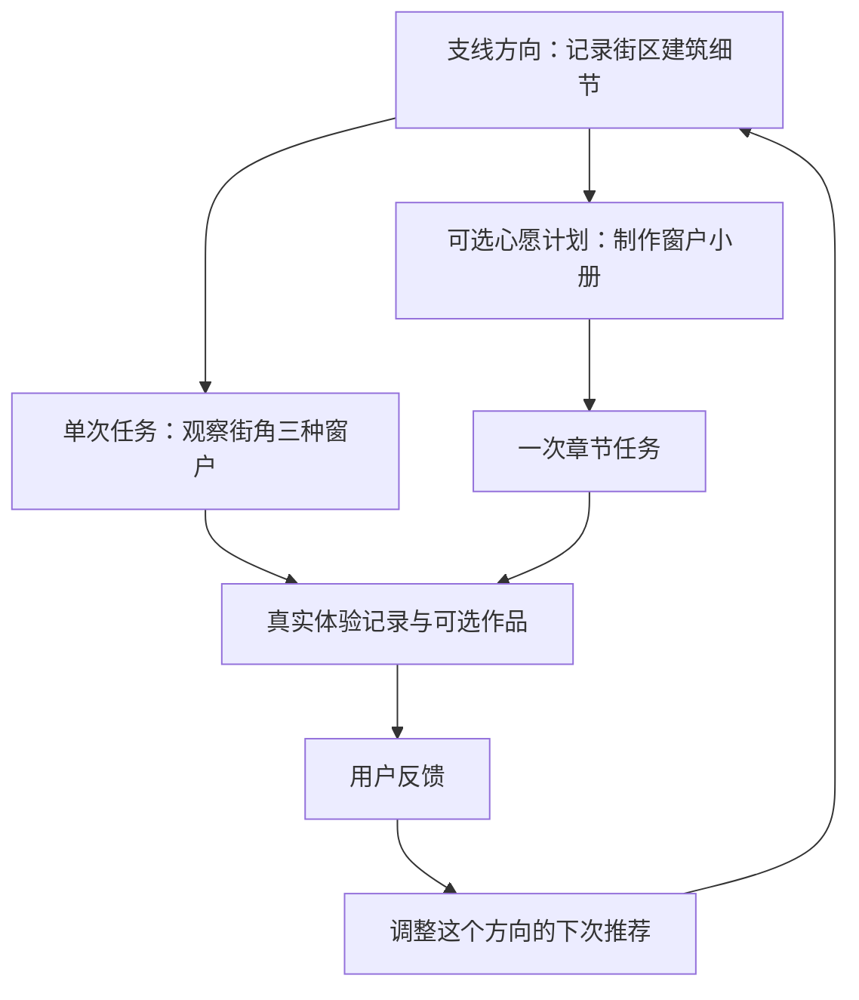

# 支线探索与维护：产品调整方案

版本：v1 · 2026-11-21

状态：待评审方案；本轮只新增文档，应用代码和运行行为均未调整。

依据：用户最新定位，以及当前产品仓库提交 `37ca83a` 的实现核对。

## 1. 本次调整的判断

产品围绕两件事组织：帮助用户探索更多有趣的事情；根据用户的喜好和实际反馈，逐渐找到愿意持续投入的几个方向，并把这些方向里的体验做得更贴合、更深入。

建议的一句话定位：

> 发现有趣的支线，把喜欢的几条继续玩下去。

产品负责推荐具体、适合用户且具备开始条件的事情，并帮助用户持续探索。放松、惊喜、表达、连接或愿望推进，可以是不同用户、不同阶段的收益，不设为全体用户共同的必选目标。

空闲时间用于判断某次任务是否合适，属于使用条件。产品同时支持“现在找一件能做的事”和“看看我喜欢的方向，下次接着做”。浏览、收藏和维护方向不要求先报时长。

本轮的核心变化是把已有能力连成以下关系：

**探索新任务 → 获得实际体验 → 留下少量反馈 → 推荐逐渐贴合 → 主动保留少数方向 → 在其中继续尝试与深入。**

### 1.1 已确认与本方案建议

| 类型 | 内容 |
|---|---|
| 用户已确认 | 探索与维护是两项核心能力；喜好和反馈用于收敛方向；少数方向可以深挖、做精；体验收益因人而异 |
| 沿用已有决定 | 选择具体任务前以对话为主、卡片穿插；选择后以任务页为主、对话为辅助；入门喜好少量点选，完整对比问卷独立可选 |
| 本文建议，尚待评审 | 引入“支线方向”；首页增加持续方向入口；完成后提供可跳过反馈；心愿计划纳入方向的具体实践方式；分层调整完成与记录要求 |
| 不作为既定事实 | 用户一定想成长、喜欢的事情都需要坚持、完成多就更喜欢、问卷能够准确推断全部兴趣 |

## 2. 当前项目的能力与缺口

以下是源码核对结果，不代表本轮重新验收了所有运行流程。

| 能力 | 当前已有 | 本次需要补齐或调整 |
|---|---|---|
| 首页与开场 | 语音、键盘、时间／位置／同行快捷输入；默认十五分钟起步 | 补上探索与持续的价值说明，提供“我的支线”入口；浏览方向不经过时长问答 |
| 对话推荐 | 结合当次条件、喜好档案、已完成记录生成候选；可混入心愿章节与收藏灵感 | 给候选关联稳定的方向；区分继续熟悉、相邻尝试和新方向，避免重复或单一化 |
| 任务执行 | 独立任务页、当前步骤、文字／照片提交、辅助对话、错误重试与草稿恢复 | 保留主次关系；展示所属方向与本次承接；重新审视不同活动的记录和验收负担 |
| 喜好配置 | 基础档案、独立三十组对比、相对偏好拟合；摘要用于推荐和心愿规划 | 新增实际体验反馈及其适用范围；与问卷共同使用，不覆盖原答案 |
| 心愿计划 | 明确愿望生成有序章节，保留真实前序成果、暂停和续接 | 承接有明确成果的持续实践；补上没有终点的开放支线方向 |
| 日常记录 | 完成任务、原始文字与照片、分类和成就；完成历史可作为推荐上下文 | 记录与方向、体验反馈形成关联；完成次数和喜欢程度分开 |
| 灵感收藏 | 收藏具体想法或公开素材，整理成任务后进入推荐 | 收藏任务可关联方向，但收藏一个想法不自动关注整个方向 |
| 反馈学习 | 对话可表达偏好，当次信息和历史记录可影响推荐 | 未发现独立、可修正的“体验反馈 → 长期推荐调整”闭环；需新增持久化对象 |

当前助手设定还预设了找回溜走的时间、情绪陪伴、做完留痕等价值，开场主要围绕时长，执行环节普遍要求证物核对。因此实施时需要同步调整助手设定、阶段规则和完成约束，仅替换首页文案不足以改变产品行为。

## 3. 核心概念：具体任务、支线方向、心愿计划

| 概念 | 用户理解 | 例子 | 生命周期 |
|---|---|---|---|
| 具体任务 | 这一次可以做的一件事 | 用手机拍下街角三种不同的窗户 | 候选 → 选择 → 进行 → 完成或放下 |
| 支线方向 | 我愿意继续尝试的一类事情 | 记录街区的建筑细节 | 候选建议 → 用户保留 → 持续探索；可暂停、恢复或归档 |
| 心愿计划 | 某个方向里有明确成果的一段计划 | 做一本街区窗户小册 | 草稿 → 启用 → 分章推进；可暂停，最终完成 |
| 日常记录 | 某次真实做过的事情及留下的内容 | 某天拍的照片、当时的发现 | 保存后可回看，并可关联一个方向 |
| 灵感收藏 | 以后可能想试的具体点子或素材 | 一篇观察窗户形状的文章 | 收藏、调整、参与推荐或暂不推荐 |

关系示例：

规则：

1. 临时体验可以独立存在，不强制归入方向，也不要求最终转成长期计划。
2. 方向可以持续很久，没有必填终点、截止日期或整体完成百分比。
3. 心愿计划保留明确成果及章节次序，不能只改名就当作开放方向。
4. 一期每个任务至多关联一个主要方向，其他相似性作为标签；方向可以关联多次任务和多个计划。
5. 任务的“探索”分类与“探索新方向”的推荐方式分开：创造、连接、感官等任务同样可以用于探索。
6. 已关注方向只能由用户主动保留、创建或恢复。系统可以建议，不能因为一次点击或完成就自动启用。

## 4. 三种使用情境，共用同一套产品

### 4.1 还不知道自己喜欢什么

用户打开应用，说“给我推荐点新东西”，或直接描述现有条件。

系统展示少量差异明确的任务，用户可以直接选，也可以继续聊。无需先填写问卷、收益目标或心愿。选择具体任务后进入任务页。体验结束后可一键反馈，也可直接离开。

结束状态：得到一次体验；即使没有关注任何方向，也算有效使用。

### 4.2 发现一个愿意继续的方向

用户喜欢某次任务，选择“以后还想试这个方向”。系统展示一个可编辑的方向名和一句说明，用户确认后加入“我的支线”。已有相近方向时优先建议归入，避免重复创建；归并也需要确认。

以后可以从首页或“我的支线”接着找任务。系统利用上次实际内容、反馈和当下条件，提供同方向的新尝试。

结束状态：方向被明确保留，下次能找到；无需立即生成完整计划。

### 4.3 已有持续兴趣，希望进一步做精

用户从方向详情选择“接着玩”，或说“我想继续拍窗户，这次试试构图”。

系统保留主体，改变一项练习重点，或承接前一次作品做比较、修改。用户若希望形成具体成果，可选择“做成一个小计划”，复用现有心愿章节能力。

结束状态：留下有承接的体验或作品；用户决定继续、调整重点、暂停，或回到新方向探索。

这些是同一用户的不同情境，不划分为入门／高级账户，不按完成次数强制升级。

## 5. 页面与入口调整

### 5.1 首页：探索是默认入口，持续方向始终可达

保留吱呀、现有视觉、语音和键盘。沿用“生活有主线，快乐在支线”的品牌表达，增加具体功能说明，例如“发现想试的小事，把喜欢的继续玩下去”。

- 主入口：“找点新鲜事”，进入现有主对话，可直接说想法或使用快捷条件。
- 持续入口：“我的支线”；已有方向时展示最近的一至三条及“接着玩”。数量是首屏展示建议，不是关注上限。
- 当前任务进行中时，优先显示“继续当前任务”，避免误建并行执行任务。
- 没有方向时用一句话说明“遇到喜欢的，可以留在这里”，不要求先创建。
- 时间、地点、预算和同行作为任务可行性的条件；浏览方向不需要填写。条件不足时给候选标注适用范围，在确认开始前补齐真正影响能否执行的信息。
- 用户没有时长也不想填写时，仍可沿用十五分钟的快捷试探，明确这是可调整的起步范围；不把默认值当作用户已陈述的事实。
- 不新增必选的“放松／表达／连接”等收益问答，不延长进入推荐前的路径。

### 5.2 选前对话：让任务和持续方向出现在同一条推荐流

推荐卡先清楚说明“做什么、约需多久、需要什么条件”，再用一个短标记解释来源，例如“新方向”“沿着你喜欢的”“接着上次的小册”。任务步骤仍然在用户选中后生成。

卡片提供“就做这个”作为主要动作。“以后想试”收起保存该任务，“少推荐这类”用于可选反馈，两者不占主要按钮位置。保存任务只保存意向，不创建已开始或已完成记录。

“换一批”继续保留；用户不必说明理由。用户主动说“都太费劲”时，将当下体力调整用于本次候选；只有明确表达长期限制时才写入长期限制。

### 5.3 选后任务页：保持聚焦，增加承接关系

继续沿用当前 GUI 主导、辅助对话次要的布局。需要增加的内容限制在：

- 方向名及一句本次重点；独立任务不展示空的方向栏。
- 有前序体验时，可展开原始记录，明确本次沿用或改变了什么。
- 提问、返回首页、查看方向后继续当前步骤，保留草稿、照片及暂停计时状态。
- 辅助对话可调整做法或说明限制，作品仍在任务页集中提交。

进入“我的支线”是主动查看和维护，适合列表与详情。日常寻找任务仍通过主对话完成；选择方向只给推荐限定范围，尚未选择具体任务，不自动进入执行页。

### 5.4 完成页：轻反馈与下一次选择

在已有成果区域下增加可跳过的单次反馈：“喜欢／一般／不太合适”，一次点击即可保存，允许修改或撤回，不弹强制问卷。

“以后还想试这个方向”作为独立可选动作；喜欢一次体验，不等同于愿意长期关注。方向已存在时可直接保留；新方向使用就地确认，不启动完整规划流程。

后续动作按情境显示：已有方向时提供“接着探索这个方向”；始终可选“看看新东西”或直接结束。均不强制马上开始下一项任务。

完成与喜欢是两条信息：用户可以完成后觉得一般，也可以中途放下但仍对主题感兴趣。

### 5.5 我的支线：承接“维护”的主要页面

一期放入现有“我的手册”，新增“我的支线”栏目，同时从首页提供直达入口，不新增一套庞大的全局导航。

列表展示方向名称、最近一次体验、最近反馈或下一次可尝试的重点。详情集中提供：

| 区域 | 内容与动作 |
|---|---|
| 方向说明 | 我想继续尝试什么；可改名和调整范围 |
| 最近体验 | 关联的真实任务、记录、作品和可修改反馈 |
| 下次尝试 | 根据当下条件给出同方向任务；说明承接点 |
| 玩法调整 | 如“更简单一些”“多一点变化”“少一点文字记录”，可通过简短对话表达 |
| 心愿计划 | 关联现有计划，或主动创建一个有成果的小计划 |
| 维护动作 | 暂停、恢复、归档；归档仍可回看，不等同删除历史 |

同一时刻可以保留多个方向，默认突出用户最近主动选择的少数几条。暂不设置强制数量上限、催更、连续打卡或方向排行榜。

暂停后不主动混入普通推荐，仍可浏览；用户主动选择继续时，先明确恢复该方向。归档需要主动恢复后才重新参与持续推荐。暂停的是这条持续方向，不等于永久屏蔽整个兴趣主题；用户主动探索新东西时，仍以其明确限制和本次意图决定候选。

### 5.6 现有栏目如何衔接

- 喜好：基础设置和完整对比问卷均保留；新增“实际体验带来的调整”摘要及查看、修正入口。
- 心愿计划：现有入口继续可达，在方向详情中增加关联入口；不复制第二份计划或章节进度。
- 日常记录：保持全量历史，可按方向筛选。未归属方向的旧记录仍正常展示。
- 灵感收藏：保留具体任务和素材的收藏能力；支持选填方向，继续复用原始来源和暂停推荐能力。
- “以后想试”的任务意向与现有灵感统一收纳并区分来源，避免新建第三套收藏列表；不假装用户提交了外部素材或让其重新填写全文。

## 6. 推荐如何同时支持探索与收敛

### 6.1 推荐决策的顺序

1. 先排除违反明确限制和当前条件的任务，如超时、超预算、需要没有的设备或同伴。
2. 优先响应本次明确意图：“想试新的”就探索，“继续这个方向”就围绕指定方向。
3. 结合长期显式喜好、问卷趋势、实际反馈和关注方向挑选候选；一次选择的信号保持有限。
4. 检查多样性与重复：相同任务短期内不原样反复出现，保留合适的新方向。
5. 发布少量候选，并提供能被用户核对的简短推荐理由。

用户没有提供的条件必须保持未知。可通过任务的低门槛设计和适用条件标注来处理，不能编造地点、器材或资源。当前明确说“今天不想出门”适用于本次；档案里的“不拍照”持续有效，直到用户主动修改。

用户曾主动表达“这类事情让我放松”或“我喜欢能和朋友一起做的”，可以成为推荐线索；不将一次感受固化为长期目标。推荐理由优先说明具体匹配点，不替用户宣布将获得哪种情绪结果。

### 6.2 候选组合的建议

已有足够反馈时，可尝试三张候选：“熟悉方向的新玩法／相邻方向／一个不同方向”。这属于待验证的默认组合，不是固定配额。

- 新用户先提供少量差异化任务，不展示伪造的“很懂你”。
- 没有适合的持续任务时，可以全部探索；不为了凑结构推不可做的任务。
- 明确要求继续某方向时，候选都可以围绕该方向；需要暂时换题时先解释条件冲突并让用户选择。
- 明确要求新鲜事时，降低已关注方向的占比。
- 同一批中，心愿章节、收藏灵感和系统生成任务统一挑选与去重，避免多路各插一张后挤满候选。
- 即使用户喜好越来越明确，也持续保留主动探索新方向的入口。

### 6.3 “深挖、做精”的具体含义

持续任务要能说明与上次相比的承接和变化。可以是同一方法换对象、同一对象换观察角度、比较前后差异、修改一份旧作品，或把几次积累整理成一个小成果。

例如，“拍三种窗户 → 观察窗框重复线条 → 重拍同一扇窗比较构图 → 自愿整理成一页小册”。每次只增加一个清楚的新重点，随用户反馈调整；不单纯增加数量、时间或验收条目。

持续深入也可以是把同一种放松玩法做得更贴合。用户享受熟悉的重复时，推荐可以保持稳定；不默认要求提高技能、产出作品或成为专家。

例如，同样是保留“附近散步”这个方向，有人想继续发现建筑细节，有人只想在熟悉路线上安静走一会儿。前者可以获得新的观察重点，后者可以维持简单路线；两者都可以持续维护，不共用一条难度升级曲线。

内容质量检查至少覆盖：能否立即开始、动作是否清楚、材料是否具备、时间是否合理、与上次有何承接、变化是否符合用户意愿、是否重复包装同一任务。任一不满足时先修正候选，再发布。

## 7. 反馈与喜好：小交互，保留证据和纠偏能力

| 信号 | 可以支持的判断 | 不直接推出的结论 |
|---|---|---|
| 选择任务 | 此次愿意尝试，弱正向信号 | 已经喜欢或已完成 |
| 收藏任务 | 以后可能想做 | 当前可做、长期关注整个方向 |
| 完成任务 | 此次行动完成 | 喜欢、放松或获得成长 |
| 喜欢／一般／不太合适 | 这次体验的明确反馈 | 对所有相似任务持同样态度 |
| 保留方向 | 希望今后继续接触这一方向 | 已同意系统制定长期计划 |
| 换一批／未选择／离开 | 需要新候选或暂无行动 | 对未选任务或整个类别的否定 |
| 放下任务 | 本次暂停或终止 | 永久不喜欢该主题 |
| 主动说明原因 | 按原话区分内容、难度、条件、记录负担等 | 无依据扩展到其他方向 |

处理原则：

- 每条反馈关联具体任务、可选方向、当次条件、时间和来源。允许修正和撤回；重复点击只更新同一评价，不累计成多份证据。
- “不太合适”后可选原因，如“内容没兴趣／今天条件不合适／太难或太累／记录太麻烦”，不选也能离开。
- 条件问题优先修正当次匹配；明确的长期限制由用户确认后持续生效。
- 对话里发现可能的长期喜好变化时，给出可修改的小回执。含糊表达保持为当前反馈，避免默默永久改档案。
- 基础喜好、问卷答案、实际体验分别保存，不能把一次体验伪造成一份问卷答案，或覆盖用户原来的兴趣文字。
- 一期采用可解释的标签与方向汇总，问卷拟合仍沿用现有独立机制。先验证反馈是否改善推荐，再考虑更复杂的自动学习。
- 没有反馈就保留不确定性；不展示人格结论、虚构准确率或“已经彻底了解你”。

## 8. 任务完成、记录与反馈的边界

建议根据任务性质区分完成方式，避免所有体验都变成证明题：

| 任务性质 | 建议完成方式 | 记录与核对 |
|---|---|---|
| 体验型，如散步、倾听、感官尝试 | 用户明确确认完成当前动作 | 文字或照片可选；未上传时只记录用户确认，不声称验收过作品 |
| 作品型，如拍摄、写作、整理小册 | 开始前说明本次希望留下的内容 | 对用户选择提交的作品给具体反馈；需用于后续章节的材料明确保存 |
| 已开启的旧心愿章节 | 保持原章节约定 | 沿用原有证物、验收与成果关联，不能在迁移中直接放行或伪造完成 |

体验感受由用户表达，助手不代替用户判定“你已经放松”或“这对你很有意义”。作品建议、任务完成和喜好评价分别记录；“作品尚需补充”不能自动变成“不喜欢这个方向”。

此项涉及现有严格完成约束，建议作为独立实施批次。第一批可先保持现有提交流程，补齐探索与维护闭环；记录负担则单独评审和验证，不能仅在界面隐藏必填项而保留后台阻断。

## 9. 新手教程与文案调整

保持当前四模块和短演示，不增加教程页数：

1. 开场：说明“发现有趣的事，把喜欢的继续玩下去”，把十五分钟作为示例条件。
2. 演示：仍然选择一个任务、体验一次完成；收尾顺带展示“喜欢可以保留这个方向”，不再新增必须点击的一步。
3. 喜好：仍只快速设置活动节奏、预算；完整对比拟合保留在正式喜好页。
4. 心愿：继续可选，说明“已经有想持续做的事，可以先留一句”；没有愿望也能开始探索。明确区分本机心愿草稿和已保存的支线方向。

助手表达同步调整：介绍具体任务、回应实际限制、引用真实偏好和反馈。减少统一的情绪收益承诺、时间不应浪费的暗示，以及每次完成必须产出痕迹的假定。仍保留吱呀的温和语气和用户随时退出的能力。

## 10. 关键状态与异常处理

| 情况 | 预期行为 |
|---|---|
| 反馈或方向保存失败 | 原位显示未保存并可重试；不显示成功、不提前发布新偏好、不阻断已完成任务的记录 |
| 离开后保存请求才返回 | 不重开弹层、不强制跳页；再次查看时反映真实保存结果 |
| 修改或撤回反馈 | 后续推荐按最新有效信息调整；不追加重复分数 |
| 暂停或归档方向 | 停止主动推荐该方向；保留既有记录、作品和计划，计划暂停仍按各自状态处理 |
| 方向下仍有进行中的任务 | 暂停只影响后续推荐，当前任务仍可继续或主动放下；不能直接丢草稿 |
| 开始另一个任务 | 复用现有单任务执行约束，先继续或明确放下当前任务；不能悄悄覆盖 |
| 当前条件无法继续心愿章节 | 说明缺少的实际条件，提供调整条件或探索其他任务的选择；不伪造缩短版已完成章节 |
| 前序内容未记录或已不可用 | 让用户自愿补充或给出不依赖它的任务；不编造前序作品 |
| 未反馈或拒绝长期关注 | 仍可正常探索，无惩罚、无强制问卷和反复催问 |
| 模型暂时不可用 | 保留输入、方向和反馈；已有记录可回看，提供重试，不伪装成已生成个性化任务 |

## 11. 与当前项目的改动对应

本表为后续开发定位，不代表本轮已经改动。

| 范围 | 现有位置 | 建议改动 |
|---|---|---|
| 首页与教程 | `src/components/LandingScreen.tsx`、`AppOnboarding.tsx`、`OnboardingSceneTry.tsx` | 定位说明、我的支线直达、演示收尾调整 |
| 主对话与推荐卡 | `src/components/ConversationPanel.tsx`、`ActivityCards.tsx` | 候选来源、继续方向上下文、任务收藏与可选负反馈 |
| 当前任务与完成页 | `src/components/TaskWorkspace.tsx`、`TaskStep.tsx` | 方向承接、轻反馈；后续独立调整记录方式 |
| 手册、方向及计划 | `src/components/PersonalLibrary.tsx`、`GoalsView.tsx`、`JourneyContext.tsx` | 新增我的支线列表／详情；复用心愿与前序成果，保持旧入口可达 |
| 喜好与记录 | `src/components/PreferenceSheet.tsx`、`PreferenceFittingPanel.tsx`、`HandbookView.tsx`、`InspirationView.tsx` | 展示实际反馈、方向筛选与关联收藏；保留原问卷和作品 |
| 会话恢复与关联 | `src/hooks/useAgentSession.ts`、`src/session-restore.ts`、`src/types.ts` | 传递稳定的任务／方向归属，恢复查看与执行上下文 |
| 推荐与助手行为 | `server/agent/coordinator/coordinator.ts`、`context/builder.ts`、`prompts/`、`flows/`、`skills/playbook-s0` 至 `playbook-s3` | 探索／持续意图、反馈摘要、统一候选组合、定位及阶段话术；同步工具与状态约束 |
| 喜好、记录、心愿与收藏存储 | `server/agent/profile/`、`handbook/`、`server/goal-store.ts`、`inspiration.ts`、`session-store.ts` | 新增方向与反馈的独立持久化，关联已有数据；避免复制既有计划与原始作品 |
| 任务设计与完成约束 | `server/agent/tools/atom-tools.ts`、`review/evidence-reviewer.ts`、`fsm/state-machine.ts`、`server/goal-planner.ts` | 分批支持不同完成规则，保留真实成果及旧计划约定 |

新增数据最小范围：支线方向、任务到方向的关联、任务收藏意向、体验反馈及其最新有效状态。推荐理由能追溯到来源记录；方向使用稳定标识，改名后仍能关联历史。

## 12. 旧数据与兼容策略

- 保留现有喜好、问卷答案、会话、作品、灵感、心愿标识、章节进度与成就，不通过本次调整清空历史。
- 旧任务默认保持未归属方向；用户可主动选择归入，系统只能建议，不能批量自动推断已关注方向。
- 旧心愿计划先独立保留，在“我的支线”提供已有计划入口；用户选择后再建立方向关联，不自动改写计划内容或复制进度。
- 已启用计划和进行中任务维持原完成约定；新的完成模式需要明确版本和默认行为。
- 暂停、恢复、归档方向不级联删除任务、心愿、作品或收藏。方向恢复后，其下已暂停计划不会自动启用。
- 方向与反馈沿用当前用户标识进行隔离；现有机制不等于账户体系，不新增跨设备同步承诺。
- 新增内容可在旧数据没有关联字段时正常运行；支持按批次关闭新推荐策略，仍可访问原记录和计划。

## 13. 实施顺序与范围

### 第一批：做通探索与维护的最小闭环

先完成定位与助手规则调整、可跳过的体验反馈、方向保留／暂停／继续、首页和手册入口、方向上下文进入下一次推荐。实际反馈与问卷并存，统一心愿／收藏／普通候选的组合与去重。

最低可演示路径：从推荐中选择任务 → 做完 → 反馈喜欢 → 主动保留方向 → 离开并刷新 → 找回方向 → 按当下条件获得承接上次的新任务。

同批必须覆盖“不喜欢、一般、没有反馈、不关注、暂停后不主动推荐”的分支。只补文案或只给一个空方向列表，不算闭环完成。

这一批复用现有执行和验收，不立即重做作品提交规则。

### 第二批：提高持续体验质量

补齐方向内容调整、任务意向收藏与灵感统一收纳、历史记录归入方向、心愿关联与由探索转计划。对照真实反馈验证“下一次确有承接”，逐步支持更贴合用户的难度、变化和记录方式。

独立实施体验型任务的可选记录，并同步完成约束、旧计划兼容与恢复验证。

### 第三批：有证据后再优化推荐

根据真实使用结果调整探索比例、重复间隔、反馈权重和问卷解释。必要时再增强自动学习，不在首版承诺精确画像、专业训练效果或复杂成长体系。

## 14. 验收与验证方法

### 14.1 功能验收

| 场景 | 通过条件 |
|---|---|
| 新用户探索 | 不填问卷、心愿或收益目标，也可得到差异清楚的可行候选 |
| 直接维护 | 浏览方向、暂停和恢复不要求先报时长或开始任务 |
| 喜欢但不关注 | 反馈保存，推荐可参考；我的支线不自动增加方向 |
| 完成但不喜欢 | 完成记录保留，体验反馈单独影响后续推荐 |
| 今天不合适 | 当次条件被调整，不自动把主题加入永久排除 |
| 持续方向 | 用户主动保留后刷新仍在，下次任务与真实上次体验有承接 |
| 深挖 | 能指出本次的新重点或改进；同玩法重复只有在符合用户意愿时采用 |
| 偏好纠正 | 修改或撤回反馈后，后续推荐采用最新信息，不重复累计 |
| 多来源推荐 | 同批心愿、收藏和普通任务统一去重，数量可控，不突破约束 |
| 历史兼容 | 旧心愿、问卷、作品和进行中任务可继续访问，不虚构方向或完成记录 |
| 交互连续 | 选前对话与选后任务主次保持；提问、手册往返、刷新和失败不丢合法草稿 |

实施后的回归复用现有任务流程、教程、喜好拟合、会话持久化及心愿测试，再针对方向状态与反馈闭环补充验证。覆盖手机窄屏、常规手机、横屏和桌面；只写文档的本轮不运行应用测试。

### 14.2 产品效果验证

先用少量真实使用评审验证三个问题：用户能否快速找到愿意尝试的任务；反馈后推荐是否更贴合且没有变窄；用户是否愿意主动回来继续某个方向。

观察推荐到开始的转化、实际反馈分布、方向保留后的主动续接、持续体验的满意度，以及新方向仍被尝试的情况。完成数量、使用时长和方向数量作为辅助信息，不单独代表价值。所有比例需注明样本和时间范围；样本不足时只报告现象，不宣称推荐已改善。

真实个性化推荐与持续任务质量需要配置模型后验收。页面和存储验证可以使用隔离测试数据，不能把模拟流程通过当作实际推荐质量通过。

## 15. 本方案的评审重点

1. 是否接受“具体任务／支线方向／心愿计划”三者的关系，尤其是方向可以没有终点。
2. 是否认可第一批先补实际反馈与方向持续闭环，并复用现有任务执行。
3. 是否接受首页直达、手册内维护的轻量入口，以及少数方向突出但不设硬上限。
4. 是否接受后续按任务性质降低记录负担，并保持旧心愿的真实成果约定。

以上是供讨论的产品方案，尚不构成对具体交互细节、推荐配比或实施批次的最终确认。
